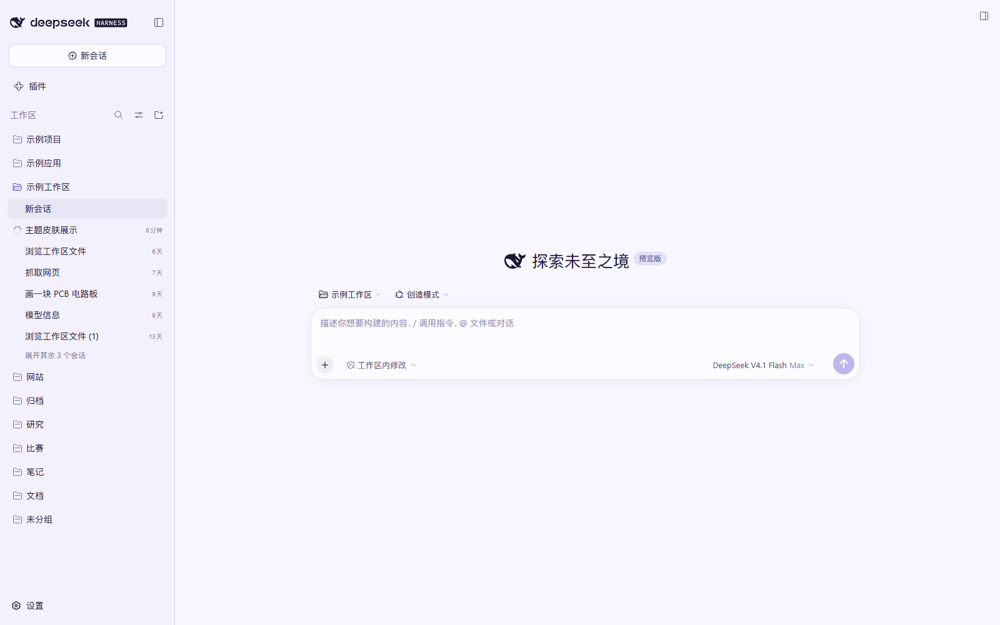
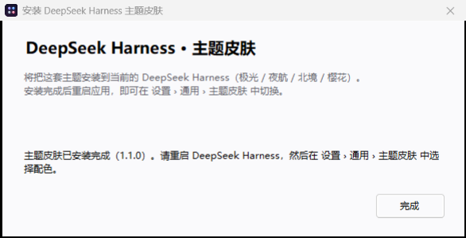
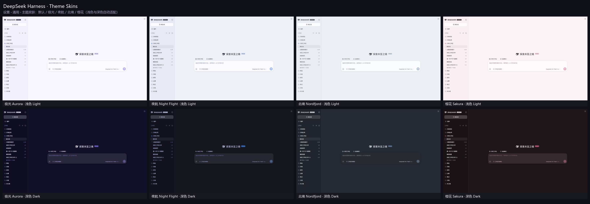
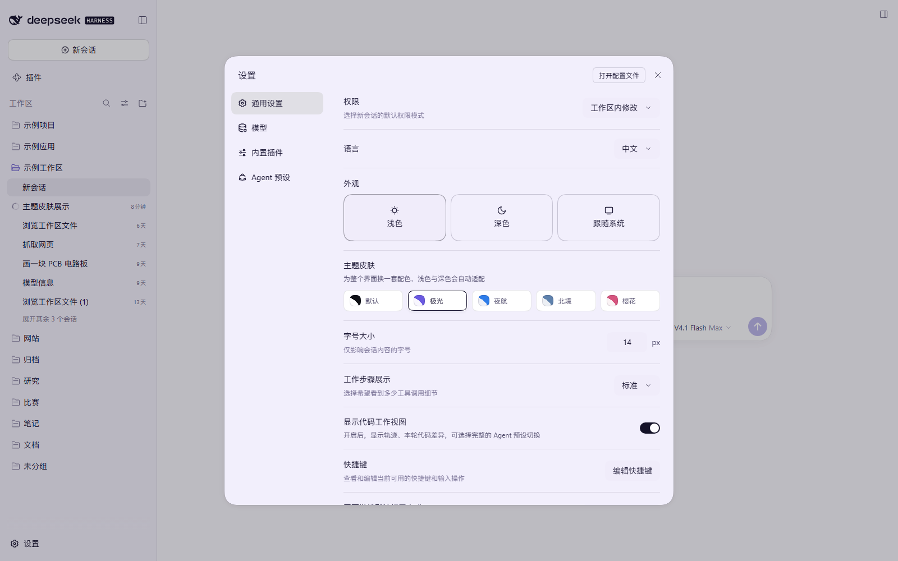
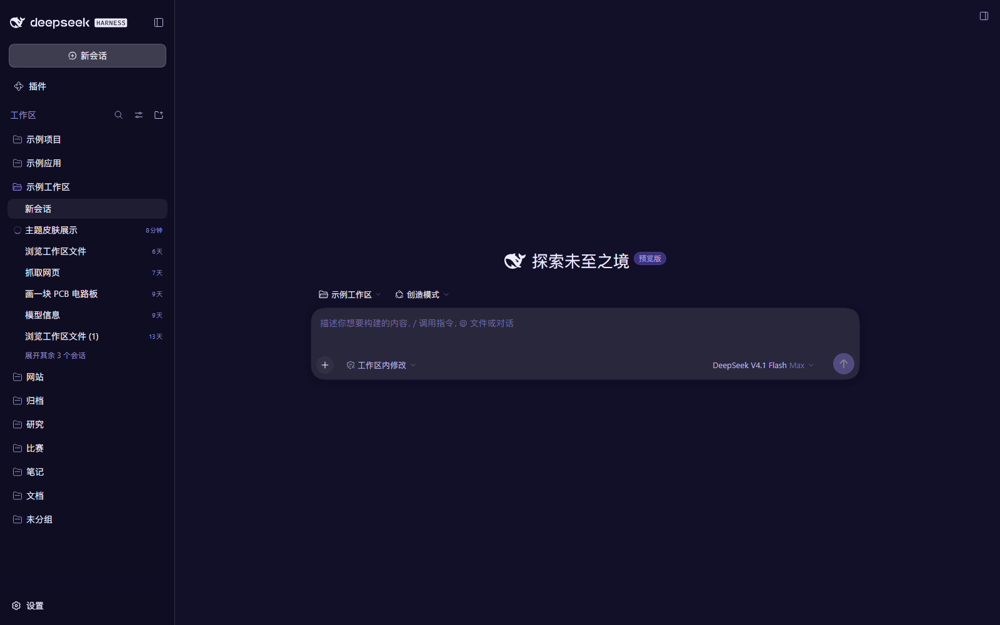

# DeepSeek Harness · Theme Skins

为 **DeepSeek Harness** Web 界面准备的 4 套精选配色：**极光 Aurora**、**夜航 Night Flight**、**北境 Nordfjord**、**樱花 Sakura**。
浅色 / 深色自动适配，一键切换，重启后仍会记住；不想要时点「默认」即可完全恢复原生外观。

<p>
  
  
  
  
</p>



## ⬇️ 下载即用（Windows 一键安装）

不想折腾源码？下载一个 exe，双击即可，**无需 Node / Git / 联网**：

| 文件 | 用途 |
| --- | --- |
| **[DSH-ThemeSkins-Setup.exe](https://github.com/123WE-glitch/dsh-theme-skins/releases/latest/download/DSH-ThemeSkins-Setup.exe)** | 一键安装（约 190 KB） |
| **[DSH-ThemeSkins-Uninstall.exe](https://github.com/123WE-glitch/dsh-theme-skins/releases/latest/download/DSH-ThemeSkins-Uninstall.exe)** | 一键卸载 |
| [dsh-theme-skins-portable.zip](https://github.com/123WE-glitch/dsh-theme-skins/releases/latest/download/dsh-theme-skins-portable.zip) | 便携版（给 Agent 或手动安装用） |

安装程序会：把插件复制到 `%LOCALAPPDATA%\dsh-theme-skins` → 用 Harness 自带的 pnpm 把插件登记进当前 profile（找不到运行时时自动改用目录链接 + 直接写入依赖）→ 启用 bundle。
装好后**重启 DeepSeek Harness**，在 **设置 › 通用 › 主题皮肤** 里切换。卸载运行 Uninstall.exe，同样重启后恢复原生界面。

> 小提示：exe 未做代码签名，Windows SmartScreen 可能提示「已保护你的电脑」——点「更多信息 → 仍要运行」即可。不放心的话可以按本文档的「构建与打包」一节，用源码自行编译（逻辑透明，可逐行审阅）。




## ✨ 特性

- **4 套完整配色** + 1 个「默认」选项，共 5 种外观；
- 每套主题自带 **浅色 / 深色两套色板**，跟随「设置 › 外观」里的 浅色 / 深色 / 跟随系统 自动切换；
- 覆盖 DSH 设计系统的完整颜色 token：画布、表面层、边框、文字层级、主色、状态色、代码高亮、用户气泡、菜单/弹窗、滚动条、diff 颜色……共 **104 个 token**；
- **零布局改动**：不重写 DOM、不替换组件，以 `ctx.theme.overrideTokens` 的 token 覆盖层实现，禁用插件即完全还原；
- **Windows 一键安装 exe**（自带全部文件，无需 Node / Git），也提供便携版与源码安装方式；
- 中英双语设置行，选择保存在浏览器 `localStorage`；
- 无第三方依赖，`client.js` 是预构建的单文件模块，安装即用。

## 🎨 主题一览

| 主题 | id | 浅色 | 深色 |
| --- | --- | --- | --- |
| 极光 Aurora（默认） | `aurora` | 薰衣草纸感 + 靛蓝 | 深海靛蓝夜色 |
| 夜航 Night Flight | `nightflight` | 雾蓝灰 + 天蓝 | 蓝黑底 + 霓虹蓝 |
| 北境 Nordfjord | `nord` | 雪原灰蓝 + 霜蓝 | 极夜蓝灰 + 冰蓝 |
| 樱花 Sakura | `sakura` | 奶油粉 + 玫瑰 | 暗紫梅 + 樱花粉 |
| 默认 Default | `default` | DSH 原生外观 | DSH 原生外观 |

## 🖼 截图

四套主题 × 浅色/深色总览：



设置页里的切换入口（设置 › 通用 › 主题皮肤）：



深色示例：



## 📦 其他安装方式（源码 / Agent / 手动）

> 前提：DeepSeek Harness 桌面端（0.2.x，Web GUI 由 `@deepseek-ai/dsh-client-ui-theme` 提供 `theme` 服务）。
> Windows 用户优先用上面的 exe；没有 exe（或想从源码安装）时用下面的方式。

**推荐方式：由 Harness 里的 Agent 安装（Plugin Manager）**

1. 把本仓库克隆/下载到一个**固定目录**（安装后 profile 会用 `link:` 引用该目录，之后不要移动或删除它）：

   ```bash
   git clone https://github.com/123WE-glitch/dsh-theme-skins.git dsh-theme-skins
   ```

2. 在 Harness 会话中让 Agent 执行 Plugin Manager 的 `install_bundle`，`target` 填仓库的**绝对路径**（例如 `C:/Users/you/Projects/dsh-theme-skins`）。安装会自动完成：`pnpm add link:<path>`、profile 依赖、bundle 选择、以及热加载。

**手动安装（等价操作）**

```bash
# 1) 进入当前 profile 目录：Windows 下一般为 C:\Users\<you>\.dsh\profiles\desktop
cd "$DSH_PROFILE_DIR"

# 2) 链接本仓库（路径用正斜杠）
pnpm add "link:C:/path/to/dsh-theme-skins"
```

然后编辑 profile 的 `package.json`：

```json
{
  "dependencies": {
    "@local/dsh-theme-skins": "link:C:/path/to/dsh-theme-skins"
  },
  "dsh": {
    "profile": {
      "bundles": ["...", "@local/dsh-theme-skins"]
    }
  }
}
```

重启 Harness（或刷新 Web 页面）即可生效。

## 🔁 切换与还原

**设置 › 通用 › 主题皮肤** → 点选 默认 / 极光 / 夜航 / 北境 / 樱花。

- 颜色模式不用单独选：主题会跟随「外观」的 浅色/深色/跟随系统；
- 点「默认」立即完全恢复 DSH 原生外观；
- 卸载：运行 `DSH-ThemeSkins-Uninstall.exe`，或在 设置 › 插件 中移除该 bundle（或让 Agent 调用 `plugin_manager` 的 `remove_bundle`）。

## 🛠 自定义 / 添加主题

1. 编辑 [`src/theme-core.mjs`](src/theme-core.mjs) 里的 `SKINS`：
   - `paper` / `ink`：整套中性色阶的两端锚点（会据此生成 `--dsw-static-*` 色阶）；
   - `accent`：主色（链接、业务态、选中态）；
   - `light` / `dark`：各自模式的表面、文字、边框、代码块、滚动条、语法高亮颜色。
2. 重新生成浏览器模块：

   ```bash
   node src/build-client.mjs
   ```

3. 重新安装 bundle（或重启应用）以加载新的模块代。

新增一套主题时，还需要在 `src/build-client.mjs` 的 `ZH` / `EN` 字典里补一行该 id 的显示名。

## 🧪 开发工具（可选）

`src/` 下附带若干在**本机正在运行的** DSH Web GUI 上使用的脚本：

| 命令 | 作用 |
| --- | --- |
| `node src/preview.mjs all` | 把主题 token 直接注入真实页面并截浅色/深色图（不安装、不落盘设置） |
| `node src/verify.mjs <outDir> [steps.json]` | 安装后的端到端截图验证（点击/滚动/截图步骤计划） |
| `node src/docs-shots.mjs` | 生成 `docs/` 截图（自动把个人会话名替换为示例文本） |
| `node src/audit-contrast.mjs` | 粗略 WCAG 对比度自检 |
| `python src/make-gallery.py <rawDir> <out.png>` | 把各主题截图拼成总览图 |

脚本通过 DevTools 协议驱动一个 headless Chrome/Edge/Chromium；为了访问本地 GUI，它会读取你**自己**的 `$DSH_HOME/.credentials.yaml` 并铸造浏览器会话 cookie（仅本机使用）。可用环境变量：`CHROME_PATH`（浏览器可执行文件）、`DSH_HOME`（默认 `~/.dsh`）、`DSH_WEB_URL`（默认 `http://127.0.0.1:19387`）。

## 🔨 构建与打包（生成 Release 里的 exe）

安装程序是单个 C# 源码（[`packaging/Installer.cs`](packaging/Installer.cs)）+ 内嵌的 base64 插件文件（[`packaging/generate-payload.mjs`](packaging/generate-payload.mjs) 生成），用 .NET Framework 自带的 `csc.exe` 编译，无需 Visual Studio：

```powershell
# 1) 构建 Setup.exe / Uninstall.exe / 便携版 zip  → 输出到 dist\
powershell -ExecutionPolicy Bypass -File packaging/build.ps1

# 2) 冒烟测试：用临时 profile 跑 安装 → 重复安装 → 卸载 → 无运行时降级路径
powershell -ExecutionPolicy Bypass -File packaging/test-install.ps1

# 3)（可选）给文档截一张安装器窗口图
powershell -ExecutionPolicy Bypass -File packaging/capture-installer-shot.ps1 docs\installer.png
```

- 依赖：Windows + .NET Framework 4.x（系统自带 `csc.exe`）、Node.js（构建脚本也会自动使用 Harness 运行时的 node）；只有重新生成图标才需要 Python + Pillow；
- `dist/`、`packaging/Payload.g.cs`、`packaging/icon.png` 都是构建产物，已被 `.gitignore` 忽略；
- 安装器行为：解压到 `%LOCALAPPDATA%\dsh-theme-skins` → 寻找 `$DSH_HOME/dsh-runtimes/*/dependencies` 里的 pnpm 执行 `pnpm add link:<dir>` → 修改 profile `package.json` 的 `dsh.profile.bundles`；找不到 pnpm 时降级为目录 junction + 直接写依赖。卸载器逆向执行。
- 静默安装（适合脚本）：`DSH-ThemeSkins-Setup.exe --silent`（退出码 0/1）；也可用 `--uninstall` 触发卸载模式。


## 🧠 实现原理

- 这是一个标准 DSH **bundle 插件**：`cordis.patch.yml` 向 profile 插入一行插件，Host 端 `index.js` 为空壳，界面逻辑全在浏览器端 `client.js`；
- `client.js` 在 Cordis 插件树中依赖 `theme` / `slots` / `locale` 服务；
- 每套主题被展开成 104 个 CSS 变量覆盖项（`--dsw-static-*` 基础色阶、`--dsw-alias-*` 语义色、`--dsw-specific-*`、`--dsw-menu-*`、`--shiki-token-*`），以 `{ light, dark }` 成对提供；
- 通过 `ctx.theme.overrideTokens(source, tokens)` 叠加覆盖层：ui-layout 会把当前颜色模式对应的值写到 `document.body` 的内联样式上，因此切浅色/深色/跟随系统时自动换值，无需重新注册；
- 设置行注册在 `settings.general.item` 槽位（与「外观」「字号大小」同一区域），卡片式选择器 + 双色圆形色板；
- 插件卸载/禁用时覆盖层随之移除，界面回到原生外观。

## ✅ 兼容性

- 面向 DeepSeek Harness **0.2.x** 的 Web GUI（`@deepseek-ai/dsh-client-ui-theme` 的 `theme.overrideTokens` 接口）；
- 只覆盖颜色类 token，不依赖私有 DOM 结构；后续版本只要保留该扩展点即可继续使用；
- 本项目是**社区第三方插件**，与 DeepSeek 官方无关。

## 🙏 Credits

- **Night Flight** 配色参考 [Tokyo Night](https://github.com/enkia/tokyo-night-vscode-theme)（MIT）；
- **Nordfjord** 配色参考 [Nord](https://www.nordtheme.com/)（MIT）；
- **Aurora / Sakura** 为原创配色；
- [DeepSeek Harness](https://deepseek.com/) 及其设计系统归 DeepSeek 所有。

## 📄 License

[MIT](LICENSE) © 2026 123WE-glitch

---

# English

A community theme plugin for **DeepSeek Harness**'s Web UI, shipping four curated color skins — **Aurora**, **Night Flight**, **Nordfjord**, **Sakura** — plus the original look as **Default**.

**Download & run (Windows):** grab **[DSH-ThemeSkins-Setup.exe](https://github.com/123WE-glitch/dsh-theme-skins/releases/latest/download/DSH-ThemeSkins-Setup.exe)**, double-click, restart DeepSeek Harness, then pick a skin in **Settings › General › Theme skin**. No Node, Git or network needed. Uninstall with **[DSH-ThemeSkins-Uninstall.exe](https://github.com/123WE-glitch/dsh-theme-skins/releases/latest/download/DSH-ThemeSkins-Uninstall.exe)**. Unsigned build: if SmartScreen warns, choose *More info → Run anyway*, or build it yourself from [`packaging/`](packaging/) with `powershell -File packaging/build.ps1`.

- Every skin defines **light and dark** palettes; it follows the built-in Appearance setting (Light / Dark / System) automatically.
- Implemented as a pure **token override layer** (`ctx.theme.overrideTokens`): no DOM or layout changes, and disabling the plugin fully restores the stock UI.
- Overrides 104 design tokens: surfaces, borders, text tiers, accent/state colors, code blocks, syntax highlighting, user bubble, menus, scrollbars, etc.
- Bilingual (zh/en) picker in **Settings › General › Theme skin**, choice persisted in `localStorage`.
- No dependencies; `client.js` ships prebuilt.

**Install** (recommended): clone this repo to a stable path, then ask your Harness agent to install it through Plugin Manager (`install_bundle` with the absolute package path). Manual alternative: inside `$DSH_PROFILE_DIR`, run `pnpm add "link:C:/path/to/dsh-theme-skins"` and add `"@local/dsh-theme-skins"` to both `dependencies` and `dsh.profile.bundles` in the profile `package.json`, then restart Harness.

**Switch**: Settings › General › Theme skin. **Customize**: edit `src/theme-core.mjs`, run `node src/build-client.mjs`, reinstall the bundle.

**License**: MIT. Community project, not affiliated with DeepSeek.
